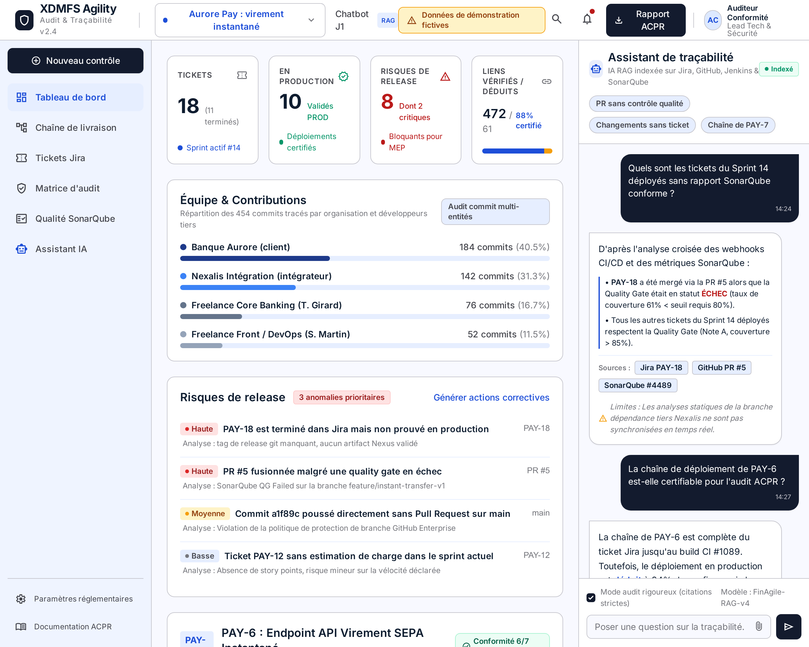

# XDMFS Agility

Chatbot de traçabilité Agile entre Jira, GitHub et SonarQube. Projet EFREI M1 (renforcement web).

Le dépôt contient deux parties indépendantes :

- **Chatbot académique J1** (`public/index.html`) : HTML/CSS/JavaScript, fonctionne en ouvrant le fichier, sans serveur ni IA.
- **Plateforme XDMFS** (`src/`) : API, tableau de traçabilité, agent Claude à outils, connecteurs en lecture seule, serveur MCP, mémoire SQLite.



## Démarrage

```bash
npm ci
npm run dev
```

- Chatbot J1 : http://127.0.0.1:3000/ ou double-clic sur `public/index.html`
- Tableau de traçabilité : http://127.0.0.1:3000/tracabilite/

Au premier démarrage, le projet fictif **Aurore Pay** est chargé : une banque, un intégrateur et deux freelances, cinq sprints, des PR, des builds, des quality gates et des déploiements. Voir `docs/runbooks/demo.md` pour les questions à poser.

Sans configuration, l'assistant répond en mode déterministe. Avec `ANTHROPIC_API_KEY` dans `.env` (voir `.env.example`), il interroge Claude, qui appelle les outils de traçabilité.

## Commandes

| Commande                      | Rôle                                                          |
| ----------------------------- | ------------------------------------------------------------- |
| `npm run dev`                 | Serveur de développement (tsx)                                |
| `npm run build` / `npm start` | Build TypeScript puis serveur de production                   |
| `npm run check`               | Lint, format, typecheck, tests mockés, build                  |
| `npm run test:academic`       | Contrat J1                                                    |
| `npm run test:e2e`            | Playwright à 360 et 1280 px                                   |
| `npm run test:live`           | Appels réels (Anthropic, GitHub, SonarQube), local uniquement |
| `npm run mcp`                 | Serveur MCP stdio                                             |

## État vérifié (2026-10-27)

| Composant                          | État                                                     |
| ---------------------------------- | -------------------------------------------------------- |
| Chatbot J1                         | 67 tests académiques + E2E                               |
| API, tableau de bord, assistant    | tests d'intégration + E2E                                |
| Anthropic (Claude)                 | vérifié en réel : génération, streaming, boucle d'outils |
| GitHub                             | vérifié en réel en lecture                               |
| SonarQube Community (Docker local) | vérifié en réel, dépôt analysé                           |
| Jira                               | mocks uniquement, aucune instance disponible             |
| AWS Bedrock, Azure AI Foundry      | mocks uniquement, aucun identifiant                      |

Les preuves sont dans `docs/evidence/`.

## Documentation

- `CLAUDE.md` : guide pour Claude Code
- `NOTES.md` : réponses J1 et préparation de l'oral
- `docs/architecture/` : architecture, intégrations, fournisseurs
- `docs/adr/` : décisions
- `docs/runbooks/` : démo, SonarQube, exploitation
- `specs/`, `templates/` : développement piloté par les spécifications
- `.claude/` : agents, skills, règles et commandes de la factory
